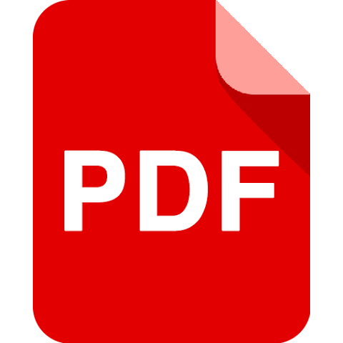

# MYPDF - Mobile Document & PDF Viewer

<p align="center">
  
</p>

<p align="center">
  <strong>A high-performance, modern Flutter mobile PDF reader and office document manager with smooth kinetic scrolling, reading comfort modes, and deep Android system integration.</strong>
</p>

<p align="center">
  
  
  
  
</p>

---

## About The Project

**MYPDF** is a lightweight, offline-first mobile document reader and file manager built with Flutter. While most mobile PDF applications are cluttered with intrusive ads, slow startup times, mandatory cloud account registrations, and heavy paywalls, MYPDF is engineered with a single goal: **to provide an instant, distraction-free, and privacy-respecting document reading experience.**

### Why MYPDF?
- 🚀 **Blazing Fast & Smooth**: Powered by custom kinetic momentum scroll physics (`FastMomentumScrollPhysics`) and background isolate directory scanning, ensuring immediate startup and fluid 120Hz display performance.
- 🔒 **100% Private & Offline**: Your documents never leave your phone. Zero telemetry, zero analytics tracking, and zero cloud uploads.
- 📂 **Unified Document Hub**: Beyond PDFs, MYPDF automatically discovers, categorizes, and organizes Word documents (`.docx`, `.doc`), Excel spreadsheets (`.xlsx`, `.xls`, `.csv`), and PowerPoint presentations (`.pptx`, `.ppt`) with one-tap system office app launch.
- 📖 **Tailored for Reading Comfort**: Includes custom Warm Sepia, OLED Dark inverted, and Daylight color matrix filters, page bookmarks, and persistent reading progress that remembers where you stopped.
- 📱 **Deep Native OS Integration**: Registers as your device's system viewer for PDFs opened from WhatsApp, Gmail, Downloads, and Drive with security-hardened cache isolation.

---

## Key Features

### 1. High-Performance PDF Reader Engine
- **Continuous & Single Page Modes**: Seamless continuous vertical scrolling or classic single-page flip layout.
- **Pinch-to-Zoom (up to 400%)**: Smooth multi-touch zoom with double-tap zoom reset and quick zoom presets (100% to 400%).
- **Interactive Page Thumbnails**: Slide-up thumbnail drawer displaying active page badges, rapid page navigation, and bookmark indicators.
- **In-Document Keyword Search**: Real-time debounced keyword search with match counter (e.g. `3 / 12`), previous/next match controls, and visual highlights.
- **Page Bookmarking**: Bookmark key pages for rapid recall; filter thumbnails by bookmarked pages in one tap.

### 2. Multi-Format Office Document Hub
- **Universal Document Support**: Organizes and manages **PDF**, **Word** (`.docx`, `.doc`), **Excel** (`.xlsx`, `.xls`, `.csv`), and **PowerPoint** (`.pptx`, `.ppt`) files.
- **Category Filter Tabs**: Interactive bottom navigation bar with real-time badges displaying live document counts for **All**, **PDF**, **Word**, **Excel**, and **PPT**.
- **System Office App Integration**: Opens Word, Excel, and PowerPoint documents with full fidelity in Microsoft 365, Google Docs/Sheets/Slides, or WPS Office.

### 3. Reading Comfort Modes
- **Light Mode**: Clean daylight reading experience.
- **Warm Sepia Mode**: Amber color matrix filter reducing blue light exposure and eye fatigue.
- **Night / OLED Dark Mode**: Inverted high-contrast dark matrix designed for low-light environments.
- **Immersive Fullscreen**: Tap anywhere on a document page to hide top and bottom bars for distraction-free reading.

### 4. File Management & Productivity
- **Multi-Selection Mode**: Long-press any file card or choose "Select" to enter batch selection mode.
- **Batch Actions**: Share multiple documents simultaneously or permanently delete files with a confirmation safety dialog.
- **In-App File Renaming**: Rename local documents directly with invalid character validation (`\ / : * ? " < > |`) and automatic extension locking.
- **Persistent Reading Progress**: Automatically saves the last-read page for each document and restores your position upon reopening.
- **Instant Library Search**: Instant search filter to find any document by file name or parent folder path.

### 5. Smart Storage Scanner & Native Intents
- **Automatic Device Storage Scanner**: Background isolate auto-discovers documents from `Downloads`, `Documents`, `Books`, `WhatsApp Documents`, and external SD cards without UI lag.
- **Native Android System Viewer**: Registered in `AndroidManifest.xml` as a system default viewer for `application/pdf`, opening attachments directly from WhatsApp, Gmail, Downloads, and Google Drive.
- **Security Hardened**: Native Kotlin intent handler with canonical path-traversal sanitization (CWE-22 prevention) and automatic cache pruning.

### 6. Kinetic Scroll Experience
- **Tailored Momentum Physics (`FastMomentumScrollPhysics`)**: Custom velocity curves and carried momentum tuned for fluid 120Hz mobile displays.

---

## Architecture & Project Structure

```text
lib/
├── main.dart                       # App entry point & System UI configuration
├── models/
│   └── pdf_document_item.dart      # Document item model, serialization & category logic
├── screens/
│   └── pdf_viewer_screen.dart      # Main document library, viewer screen & HUD controller
├── services/
│   ├── device_pdf_service.dart     # Storage scanning isolate, file operations & cache
│   └── permission_service.dart     # Storage & MANAGE_EXTERNAL_STORAGE permission handling
├── theme/
│   └── app_theme.dart              # Color palettes, typography & color filter matrices
└── widgets/
    ├── page_thumbnail_sheet.dart   # Page thumbnail modal grid with bookmark filtering
    ├── rename_pdf_dialog.dart      # File renaming dialog with validation
    ├── search_bar_overlay.dart     # Floating document keyword search bar
    └── storage_permission_dialog.dart # User-friendly storage permission dialog
```

---

## Getting Started

### Prerequisites
- [Flutter SDK](https://docs.flutter.dev/get-started/install) (`^3.10.4` or higher)
- Android Studio / VS Code with Flutter extension
- Android SDK (API level 21 or higher)

### Installation
1. **Clone the repository:**
   ```bash
   git clone https://github.com/Srikanthpv21/MyPDF.git
   cd MyPDF
   ```

2. **Install dependencies:**
   ```bash
   flutter pub get
   ```

3. **Run code analysis:**
   ```bash
   flutter analyze
   ```

4. **Run automated test suite:**
   ```bash
   flutter test
   ```

---

## Running the App

### Run on Android (Physical Device or Emulator):
```bash
flutter run
```

### Run on Windows Desktop:
```bash
flutter run -d windows
```

### Run on Web Preview:
```bash
flutter run -d chrome
```

### Build Production Release APK:
```bash
flutter build apk --release
```
The generated APK will be located at:
`build/app/outputs/flutter-apk/app-release.apk`

---

## Permissions

For Android 11+ (API 30+), MYPDF uses `MANAGE_EXTERNAL_STORAGE` to locate and manage documents across device folders (`Downloads`, `Documents`, `WhatsApp`). A permission prompt is provided to explain access benefits before requesting system permission.

---

## License

This project is licensed under the MIT License - see the LICENSE file for details.
